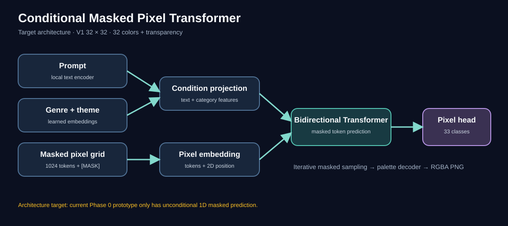
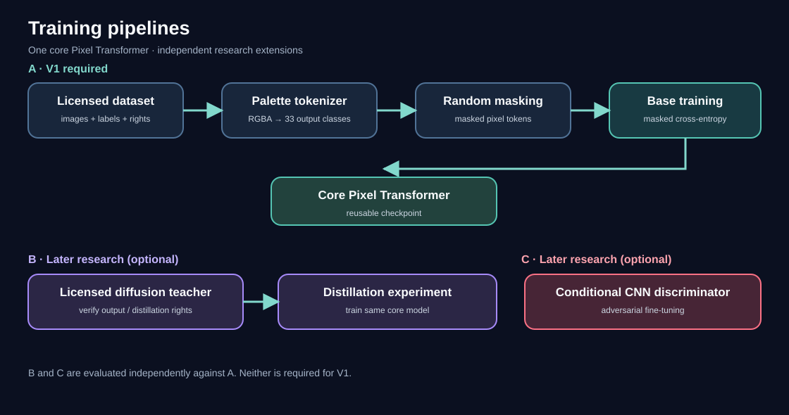

# Pixel Art Character Generator

MacBook M2 Pro에서 로컬로 학습·추론하는 픽셀아트 캐릭터 생성 프로젝트입니다. [전체 기준 명세](docs/spec.md)는 이전 대화에서 작성한 v0.2.0 문서입니다.

V1 목표는 자연어 프롬프트·장르·테마를 조건으로 자체 Conditional Masked Pixel Transformer가 32×32 캐릭터를 만들고, 투명 배경 RGBA PNG로 내보내는 것입니다. 현재는 Phase 0 기반과 무조건부 Transformer 실험 코드만 있습니다. 생성 서비스나 완성된 조건부 모델은 아직 없습니다.

## 모델 구조



자연어 프롬프트와 장르·테마 조건을 픽셀 토큰과 결합해 32×32 그리드를 예측하는 목표 구조입니다. 반복 마스크 복원 후 팔레트 디코더가 투명 배경 RGBA PNG를 만듭니다. **현재 Phase 0 코드는 무조건부 최소 모델**이며, 그림의 조건 인코더·2D 위치 인코딩·샘플러는 후속 단계에서 구현합니다.

## 학습 파이프라인



**A는 V1 필수 기본 학습**입니다. 권리를 확보한 데이터로 마스크된 픽셀을 예측하도록 모델을 학습합니다. **B(Teacher–Student)와 C(GAN)는 후속 선택 연구**이며 현재 구현 범위에 포함되지 않습니다. Teacher의 출력물을 학습에 사용할 권한도 별도로 확인해야 합니다.

## 개발 환경

Python 3.11–3.13, uv를 사용합니다.

```sh
uv sync --extra dev --python 3.13
uv run pytest
uv run ruff check .
```

[초기화 기록](docs/implementation.md)과 [Phase 1 계획](docs/phase1.md)을 참고하세요. Teacher–Student와 GAN은 후속 연구 단계입니다.
